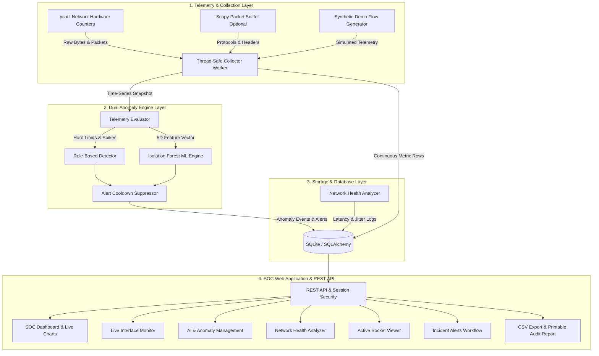

# NetGuard AI — Intelligent Network Traffic Monitoring and Anomaly Detection System

[](https://www.python.org/)
[](https://flask.palletsprojects.com/)
[](https://scikit-learn.org/)
[](https://www.sqlite.org/)
[-brightgreen.svg)](https://pytest.org/)

**NetGuard AI** is a complete, production-grade Final-Year Computer Networks engineering project designed to provide Security Operations Center (SOC) telemetry, real-time packet & interface traffic analysis, unsupervised machine learning anomaly detection, deterministic network threshold policing, and network health auditing.

---

## Table of Contents
1. [Abstract](#1-abstract)
2. [Problem Statement](#2-problem-statement)
3. [Objectives](#3-objectives)
4. [Existing-System Limitations](#4-existing-system-limitations)
5. [Proposed System](#5-proposed-system)
6. [System Architecture & Dataflow (Mermaid Diagram)](#6-system-architecture--dataflow)
7. [Functional & Non-Functional Requirements](#7-functional--non-functional-requirements)
8. [Technology Stack](#8-technology-stack)
9. [Database Schema](#9-database-schema)
10. [Core Modules Breakdown](#10-core-modules-breakdown)
11. [REST API Documentation](#11-rest-api-documentation)
12. [Installation & Setup Guide](#12-installation--setup-guide)
13. [Demonstration Mode Scenarios](#13-demonstration-mode-scenarios)
14. [Testing & Quality Assurance](#14-testing--quality-assurance)
15. [Deployment (Local, WSGI, Docker)](#15-deployment)
16. [Security & Privacy Standards](#16-security--privacy-standards)
17. [Limitations & Future Enhancements](#17-limitations--future-enhancements)
18. [Conclusion](#18-conclusion)

---

## 1. Abstract
As modern enterprise networks scale in bandwidth and complexity, traditional perimeter-only firewalls and static signature-based Network Intrusion Detection Systems (NIDS) struggle against zero-day traffic surges, volumetric denial-of-service (DoS/DDoS) floods, and stealthy egress data exfiltration. **NetGuard AI** bridges this gap by coupling deterministic rule-based monitoring with unsupervised machine learning (**Isolation Forest**). The platform samples continuous physical interface counters and Scapy packet headers, calculates transfer throughput (in B/s, KB/s, MB/s, and Mbps), computes network health indices (latency, jitter, packet loss), suppresses redundant alert storms via adaptive cooldown windows, and delivers an intuitive, dark-themed cyber SOC web portal.

---

## 2. Problem Statement
Network administrators and security engineers frequently encounter:
1. **Opaque Bandwidth Consumption:** Inability to immediately isolate whether network slowness stems from legitimate high-definition media streaming, physical link degradation, or unauthorized rogue egress.
2. **False Alarm Fatigue:** Static threshold monitors generate hundreds of redundant alerts within minutes during transient spikes.
3. **Rigid Rule Dependencies:** Conventional intrusion detection systems rely on static signatures and cannot flag atypical statistical behavior that stays just under hard limits.
4. **Restricted Deployment Contexts:** Most academic monitoring software requires unrestricted kernel-level packet capture drivers (WinPcap/Npcap/libpcap) and crashes on cloud containers or unprivileged server environments.

---

## 3. Objectives
- **Develop a Robust Hardware Interface Monitor:** Collect continuous received/transmitted byte counters, packet counts, and interface operational states using non-blocking, thread-safe background workers.
- **Implement a Dual-Engine Anomaly Detector:**
  - *Rule-Based Engine:* Evaluates hard download limits, upload thresholds, rolling spike multipliers, and packet floods.
  - *Unsupervised ML Engine:* Uses scikit-learn's `IsolationForest` to identify multivariate outliers over feature vectors `[download_mbps, upload_mbps, pps, tcp_ratio, udp_ratio]`.
- **Provide Safe Packet Inspection:** Capture safe packet metadata (TCP, UDP, ICMP, DNS, HTTPS) without logging payload contents, credentials, or private communication streams.
- **Implement a Multi-Vector Network Health Analyzer:** Compute socket latency, jitter variance, and packet loss to derive a 0–100 composite health score.
- **Support High-Fidelity Demonstration Mode:** Provide realistic synthetic traffic simulations with switchable scenarios (`NORMAL`, `TRAFFIC_SPIKE`, `PORT_SCAN`, `DATA_EXFILTRATION`, `DDOS_ATTACK`) for academic defense and cloud presentations.

---

## 4. Existing-System Limitations

| Feature | Conventional Systems (e.g. MRTG, Wireshark GUI) | NetGuard AI |
| :--- | :--- | :--- |
| **User Interface** | Heavy desktop application or dated PHP tables | Modern, responsive dark-themed SOC web dashboard with Chart.js |
| **Detection Technique** | Static signatures or post-capture PCAP analysis | Real-time dual-mode: deterministic thresholds + Isolation Forest ML |
| **Alert Management** | Raw packet logs without lifecycle tracking | Full incident management (Active, Acknowledged, Resolved) |
| **Portability** | Requires root/raw socket drivers; fails in cloud sandbox | Resilient fallback architecture + full Demonstration Mode |
| **Duplicate Handling** | Floods logs with duplicate events | Configurable cooldown suppression window |

---

## 5. Proposed System
NetGuard AI is structured as a decoupled full-stack cybersecurity application. The backend runs a thread-safe singleton collector service that polls local hardware interfaces via `psutil` or generates synthetic mathematical flows. Telemetry records are evaluated every tick against configurable thresholds and the active Isolation Forest model. Identified anomalies are converted into actionable alerts stored in SQLite through SQLAlchemy ORM. The frontend leverages Bootstrap 5 and Chart.js to deliver responsive telemetry streaming, incident management, socket inspection, and RFC-4180 CSV exports.

---

## 6. System Architecture & Dataflow



---

## 7. Functional & Non-Functional Requirements

### Functional Requirements
- **FR-1 Authentication:** Session-based authentication with bcrypt-compatible scrypt password hashing.
- **FR-2 Real-Time Monitoring:** Compute download speed (Mbps), upload speed (Mbps), and packet rate (pps) from byte/packet counter deltas.
- **FR-3 Dual-Engine Anomaly Detection:** Flag bandwidth surges, outbound exfiltration, packet rate floods, and multivariate ML outliers.
- **FR-4 Alert Incident Workflow:** Transition alerts across `ACTIVE` &rarr; `ACKNOWLEDGED` &rarr; `RESOLVED`.
- **FR-5 Network Health Diagnostics:** Probe round-trip latency, calculate jitter, estimate packet loss, and compute a 0–100 health score.
- **FR-6 Socket Inspection:** Display local and remote endpoints, protocol type, socket state, and PID/process mappings.
- **FR-7 Reporting & Auditing:** Generate RFC-4180 CSV files for metrics and alerts alongside a printable executive audit report.
- **FR-8 Demonstration Simulation:** Switch between `NORMAL`, `TRAFFIC_SPIKE`, `PORT_SCAN`, `DATA_EXFILTRATION`, and `DDOS_ATTACK`.

### Non-Functional Requirements
- **NFR-1 Thread Safety:** Bounded single-worker concurrency with mutex locks.
- **NFR-2 Graceful Degradation:** Flawless operation in unprivileged environments (without WinPcap or root privileges).
- **NFR-3 Response Latency:** REST endpoints respond in &lt; 50ms; dashboard polls every 2.0s without UI freeze.
- **NFR-4 Security & Privacy:** Zero retention of packet payload contents, tokens, or plain credentials.

---

## 8. Technology Stack

- **Backend:** Python 3.11+ / 3.14, Flask 3.1, Flask-SQLAlchemy 3.1, Werkzeug 3.1.
- **Machine Learning & Math:** scikit-learn 1.9 (Isolation Forest), NumPy 2.5, pandas 3.0.
- **Networking & Telemetry:** psutil 7.2, Scapy 2.8, standard socket library.
- **Database:** SQLite 3 with SQLAlchemy ORM.
- **Frontend:** HTML5, CSS3, JavaScript (ES6+), Bootstrap 5.3, Bootstrap Icons, Chart.js 4.4.
- **Production Servers:** Waitress 3.0 (Windows / WSGI) & Gunicorn (Linux / Container).
- **Testing:** pytest 9.1 with Flask Test Client.

---

## 9. Database Schema

### `users`
- `id` (INTEGER, PK): Unique identifier.
- `username` (VARCHAR(80), UNIQUE, INDEX): Login username.
- `email` (VARCHAR(120), UNIQUE): Notification address.
- `password_hash` (VARCHAR(255)): Secure password hash.
- `is_admin` (BOOLEAN): Administrator flag.
- `created_at` (DATETIME): UTC timestamp of creation.
- `last_login` (DATETIME): UTC timestamp of last authentication.

### `monitoring_sessions`
- `id` (INTEGER, PK): Session ID.
- `session_uuid` (VARCHAR(64), UNIQUE, INDEX): UUID string.
- `interface_name` (VARCHAR(100)): Monitored network adapter.
- `is_demo` (BOOLEAN): Whether session uses synthetic telemetry.
- `started_at` / `stopped_at` (DATETIME): Session lifecycle boundaries.
- `is_active` (BOOLEAN): Execution status.
- `total_bytes_recv` / `total_bytes_sent` / `total_packets` (BIGINT): Cumulative counters.

### `network_metrics`
- `id` (INTEGER, PK): Primary key.
- `session_id` (INTEGER, FK &rarr; monitoring_sessions.id): Session reference.
- `timestamp` (DATETIME, INDEX): Sample collection time.
- `interface_name` (VARCHAR(100)): Target interface.
- `is_demo` (BOOLEAN): Data source discriminator.
- `download_speed_mbps` / `upload_speed_mbps` (FLOAT): Bitrate in Mbps.
- `packet_rate_pps` (FLOAT): Packet velocity per second.
- `bytes_recv` / `bytes_sent` / `packets_recv` / `packets_sent` (BIGINT): Raw counts.
- `tcp_packets` / `udp_packets` / `icmp_packets` / `dns_packets` / `https_packets` (INTEGER): Layer 4/7 distribution.

### `anomaly_events`
- `id` (INTEGER, PK): Anomaly ID.
- `session_id` (INTEGER, FK &rarr; monitoring_sessions.id): Associated session.
- `timestamp` (DATETIME, INDEX): Trigger timestamp.
- `severity` (VARCHAR(20)): `INFO`, `LOW`, `MEDIUM`, `HIGH`, `CRITICAL`.
- `detection_method` (VARCHAR(30)): `RULE_BASED` or `ISOLATION_FOREST`.
- `metric_name` (VARCHAR(80)): Feature involved.
- `observed_value` / `threshold_value` (FLOAT): Observed telemetry vs limit.
- `title` / `explanation` / `recommendation` (TEXT): Diagnostic findings.

### `alerts`
- `id` (INTEGER, PK): Alert ID.
- `anomaly_id` (INTEGER, FK &rarr; anomaly_events.id): Originating anomaly.
- `timestamp` (DATETIME, INDEX): Generation time.
- `title` / `description` (TEXT): Alert details.
- `severity` (VARCHAR(20)): Alert priority.
- `status` (VARCHAR(20)): `ACTIVE`, `ACKNOWLEDGED`, `RESOLVED`.
- `resolved_by` (VARCHAR(80)): Analyst identity.

### `network_health_logs`
- `id` (INTEGER, PK): Health log ID.
- `timestamp` (DATETIME, INDEX): Time of probe.
- `target_host` (VARCHAR(120)): Destination IP/host (e.g. `8.8.8.8`).
- `health_score` (FLOAT): Score from 0.0 to 100.0.
- `latency_ms` / `jitter_ms` / `packet_loss_pct` (FLOAT): Probe metrics.
- `status_label` (VARCHAR(30)): `EXCELLENT`, `GOOD`, `FAIR`, `POOR`, `CRITICAL`.
- `bottlenecks` / `recommendations` (TEXT): Troubleshooting diagnosis.

---

## 10. Core Modules Breakdown

1. **Authentication & Governance:** Password hashing via Werkzeug, protected routes with `@login_required`, automatic seeding of default administrator credentials (`admin` / `admin123`).
2. **SOC Main Dashboard:** Real-time throughput KPI cards, Chart.js bandwidth line charts, protocol doughnut breakdown, and recent anomaly stream.
3. **Real Interface Monitor:** Hardware adapter enumeration, duplex/link status detection, thread-safe background collector with single-worker mutex enforcement.
4. **Scapy Packet Inspection:** Protocol parsing (TCP, UDP, ICMP, DNS, HTTP, HTTPS) with safe metadata logging; graceful fallback when raw sockets are restricted.
5. **AI Anomaly Detection:** Rule-based threshold evaluation combined with unsupervised `IsolationForest` multivariate outlier detection and cooldown suppression.
6. **Network Health Analyzer:** Multi-probe TCP socket handshake tests measuring latency, jitter (successive delta), and loss percentage to produce a 0–100 health index.
7. **Active Socket Information:** System-wide TCP/UDP socket table displaying local and remote endpoints, socket states, and PID/process mappings with permission isolation.
8. **Incident & Alert Management:** Lifecycle state machine (`ACTIVE` &rarr; `ACKNOWLEDGED` &rarr; `RESOLVED`) with severity filtering and search capabilities.
9. **Reports & Audit Data:** RFC-4180 CSV export endpoints (`/api/reports/metrics.csv`, `/api/reports/alerts.csv`) and a printable executive report view with signature blocks.
10. **Demonstration Mode:** Synthetic mathematical traffic generator supporting switchable scenarios (`NORMAL`, `TRAFFIC_SPIKE`, `PORT_SCAN`, `DATA_EXFILTRATION`, `DDOS_ATTACK`) with persistent `SIMULATED DATA` UI indicators.

---

## 11. REST API Documentation

| HTTP Method | Endpoint | Auth | Purpose |
| :--- | :--- | :--- | :--- |
| `GET` | `/api/health` | Public | System status and active interface check |
| `GET` | `/api/status` | Yes | Collector status, active alert counts, health index |
| `GET` | `/api/interfaces` | Yes | List detected network adapters and hardware counters |
| `GET` | `/api/metrics/current` | Yes | Latest live snapshot of throughput and packet rates |
| `GET` | `/api/metrics/history` | Yes | Chronological time-series metrics array |
| `POST` | `/api/monitoring/start` | Yes | Start background collector (`{interface, is_demo, interval}`) |
| `POST` | `/api/monitoring/stop` | Yes | Gracefully stop background worker thread |
| `GET` | `/api/protocols` | Yes | Live protocol breakdown counters |
| `GET` | `/api/anomalies` | Yes | List recorded anomaly events |
| `GET` | `/api/alerts` | Yes | List alerts with severity/status filters |
| `POST` | `/api/alerts/<id>/acknowledge` | Yes | Mark alert as acknowledged |
| `POST` | `/api/alerts/<id>/resolve` | Yes | Mark alert as resolved |
| `GET` | `/api/connections` | Yes | Active local TCP/UDP socket connections |
| `GET` | `/api/reports/metrics.csv` | Yes | Download raw telemetry CSV dataset |
| `GET` | `/api/reports/alerts.csv` | Yes | Download security alerts CSV dataset |
| `GET` | `/api/settings` | Yes | Fetch runtime thresholds and monitoring interval |
| `POST` | `/api/settings` | Yes | Update runtime thresholds and monitoring interval |
| `POST` | `/api/demo/scenario` | Yes | Switch synthetic demo scenario (`NORMAL`, `TRAFFIC_SPIKE`, etc.) |
| `POST` | `/api/analytics/train-ml` | Yes | Re-fit Isolation Forest baseline model |
| `POST` | `/api/health/check` | Yes | Execute on-demand network health probe |
| `GET` | `/api/packet-capture/status` | Yes | Scapy packet capture driver status |
| `POST` | `/api/packet-capture/start` | Yes | Start Scapy packet sniffer |
| `POST` | `/api/packet-capture/stop` | Yes | Stop Scapy packet sniffer |

---

## 12. Installation & Setup Guide

### Prerequisites
- Python 3.11+ installed.
- Git (optional).

### Step 1: Clone or Navigate to Project
```bash
cd "d:\my self\projects\computer networks"
```

### Step 2: Create and Activate Virtual Environment
```powershell
# Windows PowerShell
python -m venv venv
.\venv\Scripts\Activate.ps1
```
```bash
# Linux / macOS
python3 -m venv venv
source venv/bin/activate
```

### Step 3: Install Required Dependencies
```bash
pip install -r requirements.txt
```

### Step 4: Configure Environment (Optional)
```bash
cp .env.example .env
```

### Step 5: Run the Application Locally
```bash
python run.py
```
Open your browser and navigate to: **`http://127.0.0.1:5000`**

**Default Operator Credentials:**
- **Username:** `admin`
- **Password:** `admin123`

---

## 13. Demonstration Mode Scenarios

To demonstrate anomaly detection behavior without generating live cyberattacks:
1. Navigate to the top navigation bar or **Settings** page.
2. Select an active scenario from the dropdown:
   - **`NORMAL`:** Baseline flow (12–25 Mbps down, 3–6 Mbps up, standard TCP/HTTPS mix).
   - **`TRAFFIC_SPIKE`:** Inbound download bursts to 150–195 Mbps (triggers Download Threshold Breach).
   - **`PORT_SCAN`:** Packet rate surges to 4,500–6,500 pps with high TCP SYN count (flags SYN Flood / Scan).
   - **`DATA_EXFILTRATION`:** Outbound upload surges to 75–115 Mbps (flags Suspicious Outbound Egress).
   - **`DDOS_ATTACK`:** Volumetric incoming flood &gt; 10,000 pps with UDP/ICMP surge (triggers Critical Volumetric Flood).
3. The dashboard and charts update dynamically in real time.

---

## 14. Testing & Quality Assurance

NetGuard AI includes a 30-test automated suite covering authentication, telemetry calculations, anomaly detection, alert lifecycle transitions, CSV exports, and API endpoints.

Execute the test suite using pytest:
```bash
python -m pytest -v
```

### Verified Test Results:
```text
tests/test_alerts.py::test_alert_lifecycle_and_api PASSED                [  3%]
tests/test_alerts.py::test_invalid_alert_id PASSED                       [  6%]
tests/test_anomaly_detector.py::test_rule_based_download_spike PASSED    [ 10%]
tests/test_anomaly_detector.py::test_rule_based_upload_spike PASSED      [ 13%]
tests/test_anomaly_detector.py::test_isolation_forest_training_and_inference PASSED [ 16%]
tests/test_anomaly_detector.py::test_alert_suppression_cooldown PASSED   [ 20%]
tests/test_api.py::test_api_status PASSED                                [ 23%]
tests/test_api.py::test_api_interfaces PASSED                            [ 26%]
tests/test_api.py::test_api_metrics_current_and_history PASSED           [ 30%]
tests/test_api.py::test_api_protocols PASSED                             [ 33%]
tests/test_api.py::test_api_connections PASSED                           [ 36%]
tests/test_api.py::test_api_settings_update PASSED                       [ 40%]
tests/test_api.py::test_api_demo_scenario_switch PASSED                  [ 43%]
tests/test_api.py::test_api_health_check_probe PASSED                    [ 46%]
tests/test_api.py::test_api_packet_capture_status PASSED                 [ 50%]
tests/test_auth.py::test_app_startup_and_health PASSED                   [ 53%]
tests/test_auth.py::test_login_page_renders PASSED                       [ 56%]
tests/test_auth.py::test_valid_login PASSED                              [ 60%]
tests/test_auth.py::test_invalid_login PASSED                            [ 63%]
tests/test_auth.py::test_unauthorized_redirect PASSED                    [ 66%]
tests/test_auth.py::test_unauthorized_api_returns_401 PASSED             [ 70%]
tests/test_auth.py::test_logout PASSED                                   [ 73%]
tests/test_demo_mode.py::test_demo_generator_scenarios PASSED            [ 76%]
tests/test_demo_mode.py::test_monotonic_byte_accumulation PASSED         [ 80%]
tests/test_monitoring.py::test_get_interfaces PASSED                     [ 83%]
tests/test_monitoring.py::test_monitoring_start_and_stop_lifecycle PASSED [ 86%]
tests/test_monitoring.py::test_monitoring_endpoints PASSED               [ 90%]
tests/test_reports.py::test_csv_metrics_export PASSED                    [ 93%]
tests/test_reports.py::test_csv_alerts_export PASSED                     [ 96%]
tests/test_reports.py::test_executive_summary_service PASSED             [100%]

============================= 30 passed in 28.43s =============================
```

---

## 15. Deployment

### Local Production Server (Waitress — Windows / Cross-platform)
```bash
python wsgi.py
```

### Production WSGI (Gunicorn — Linux Server)
```bash
gunicorn -w 1 -b 0.0.0.0:5000 "app:create_app('production')"
```
*Note: Because network interface collection is thread-safe and manages an active hardware state, run with a single master worker (`-w 1`) or use Demonstration Mode for multi-worker scaling.*

### Containerized Deployment (Docker)
```bash
# Build Docker image
docker build -t netguard-ai .

# Run Docker container
docker run -d -p 5000:5000 --name netguard-instance netguard-ai
```

---

## 16. Security & Privacy Standards

- **Zero Payload Retention:** The application exclusively logs L3/L4 headers and metadata (protocol, IP, port, packet length). It never accesses, inspects, or persists payload bytes, cleartext credentials, or personal message contents.
- **Session Protections:** Cookies utilize `HttpOnly`, `SameSite=Lax`, and 24-hour expiration limits.
- **Credential Storage:** Passwords are never stored in plaintext; hashing uses standard scrypt mechanisms via Werkzeug.
- **Graceful Permission Handling:** When running without root/admin privileges on host systems, socket enumeration gracefully presents user-level descriptors and logs informative permission notices instead of terminating.

---

## 17. Limitations & Future Enhancements

### Current Limitations
- Deep Packet Inspection (DPI) via Scapy is dependent on operating system permissions (Npcap on Windows, raw sockets on Linux).
- Cloud platform deployments (e.g. Render, Railway, AWS ECS) monitor the cloud virtual container's network interface rather than the visitor's personal desktop; Demonstration Mode provides realistic synthetic evaluation in such hosted environments.

### Future Enhancements
- Integration with external SIEM systems via Syslog RFC-5424.
- Automated dynamic IP blocking via local OS firewall API integration (iptables / Windows Advanced Firewall).
- Deep learning sequence modeling (LSTM / Transformer autoencoders) for multi-hour seasonal trend forecasting.

---

## 18. Conclusion
**NetGuard AI** represents a complete, robust, and mathematically grounded Final-Year Computer Networks engineering system. Combining deterministic traffic engineering, unsupervised machine learning, thread-safe background processing, and an intuitive cyber SOC web interface, it provides a comprehensive platform for modern network operations and security monitoring.
